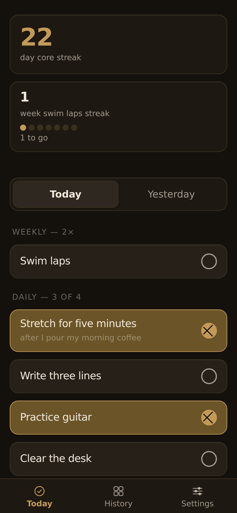
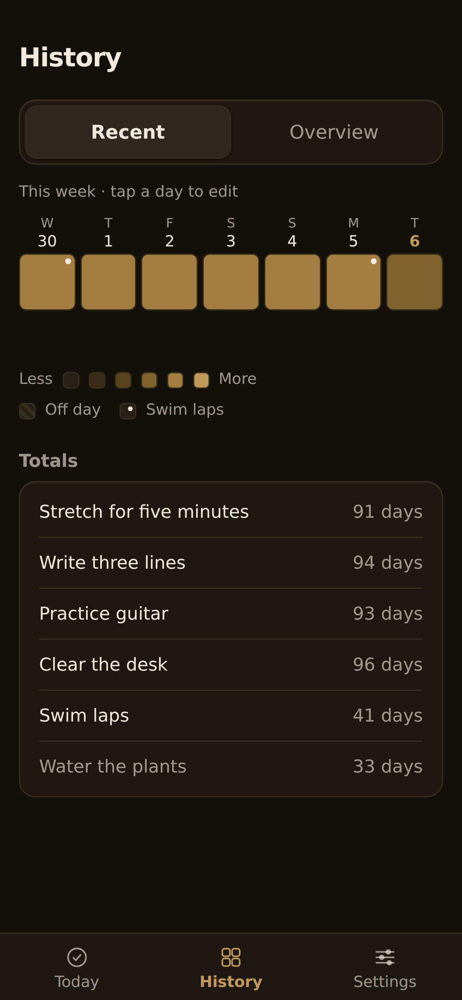
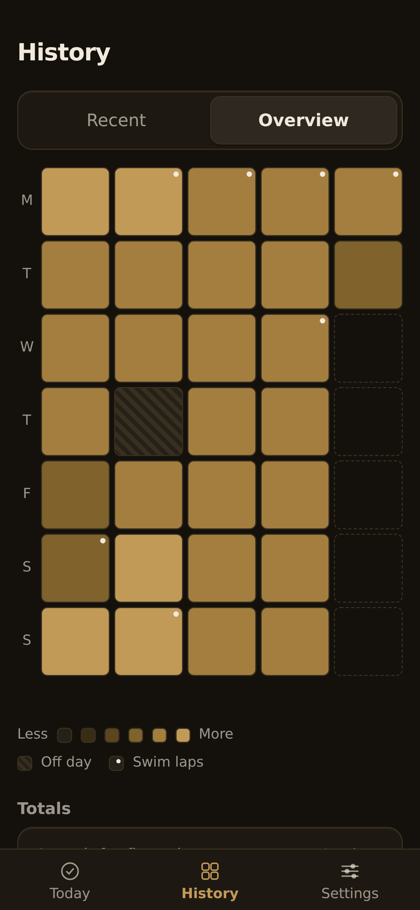
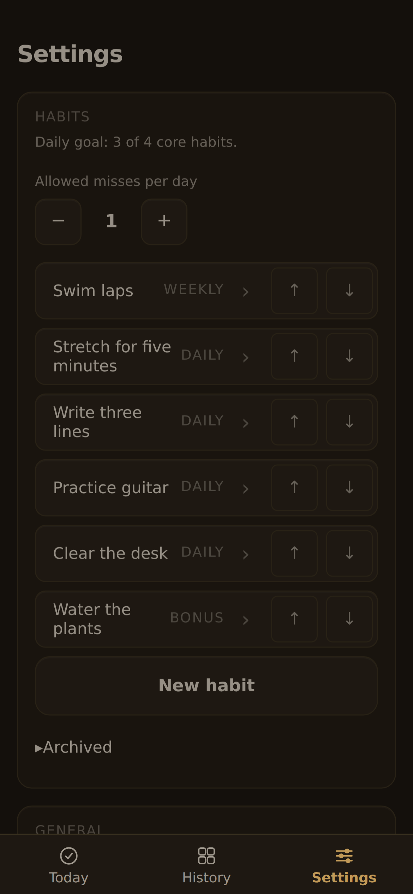

# momentum: Honest Streaks

This repo is `momentum`; the app it builds is called **Honest Streaks**.

A personal daily habit tracker, installed as a home-screen web app on iPhone. It's a single-screen, offline-capable Progressive Web App — no accounts, no backend, no tracking. Your data lives in your browser's local storage, with an optional GitHub sync for backup and multi-device use.

| Today | Recent | Overview | Settings |
|---|---|---|---|
|  |  |  |  |

*Screenshots use made-up habits and data from `tools/demo-data.mjs`.*

## Install on iPhone

1. Open **https://momentum.grantdever.com/** in Safari.
2. Tap the Share icon, then **Add to Home Screen**.
3. Launch it from the home screen icon — it opens full-screen, no browser chrome.

## Optional GitHub sync setup

Sync is off by default. To enable it:

1. Create a small **private** GitHub repo to hold your data (e.g. `momentum-data`).
2. Create a fine-grained personal access token: GitHub → **Settings → Developer settings → Personal access tokens → Fine-grained tokens** → New token.
   - **Repository access**: limit it to just the data repo you created.
   - **Repository permissions**: set **Contents** to **Read and write**.
3. In the app, open **Settings** and enter:
   - Owner (your GitHub username)
   - Repo (the data repo name)
   - Path (e.g. `data.json`)
   - Token (the fine-grained PAT from step 2)
4. Enable sync.

The token is stored **only on this device**, in the browser's local storage. It is never sent anywhere except directly to GitHub's API.

## Daily reminder

Use the iOS **Shortcuts** app to nudge yourself each evening:

1. Shortcuts → **Automation** → **+** → **Create Personal Automation**.
2. Choose **Time of Day**, set it to 9:00 PM, daily.
3. Add action: **Open URL** → the app's URL.
4. Turn off "Ask Before Running" so it fires silently.

## Data safety

- **Restoring a backup.** On a new install, tap **Restore from a backup** on the first screen (or Settings → **Import JSON**) and pick an export file. On an empty device this is a full restore: your habits come back with their original IDs and active dates, so all their history lines up, along with your preferences. On a device that already has data, an import merges days and adds any habits you don't have yet; it never renames or overwrites the habits already there. The sync token is never imported.
- The **Export JSON** button (in Settings) always works, regardless of sync status — use it to back up your data by hand at any time. This matters because iOS can evict web storage under low-disk conditions.
- If GitHub sync is enabled, every save is a commit to your data repo, so you get a free edit history.

## Moving the app to a new address

Browser storage belongs to one origin (scheme + host). An installed copy on an old address keeps its own data and can't see the new address's storage, and a redirect can't carry the data across. **Never change an installed PWA's origin without first shipping a "moving" release to the old one**, or without having every user export first. To move: export on the old install, open the new address, add it to the Home Screen, and use **Restore from a backup**. Keep the old icon until you have compared the two.

## Local development

Because this app uses ES modules, it won't run directly from a `file://` URL. Serve it locally instead:

```
python3 -m http.server 8741
```

Then open `http://localhost:8741/` in a browser.

Run the tests with `npm test` (plain Node, no dependencies).

### Screenshots

Screenshots are always taken against made-up data, never a real export:

```
python3 -m http.server 8741 &
node tools/demo-data.mjs 2026-10-06 > /tmp/demo-backup.json
PLAYWRIGHT_CORE=/path/to/node_modules/playwright-core/index.mjs CHROME=/path/to/chrome \
  node tools/screenshots.mjs http://127.0.0.1:8741/ /tmp/demo-backup.json docs/screenshots
```

The script restores the demo backup through the first-run **Restore from a backup** button, then captures Today, Recent, Overview and Settings at iPhone size (390×844 @3x). Without Playwright, you can do the same by hand: open the app in a private window with a phone-sized viewport, restore `/tmp/demo-backup.json`, and screenshot each tab.

## Notes

- After deploying an update, iOS applies the new service worker on the *next* launch — the first open after a deploy may still show the previous cached version.
